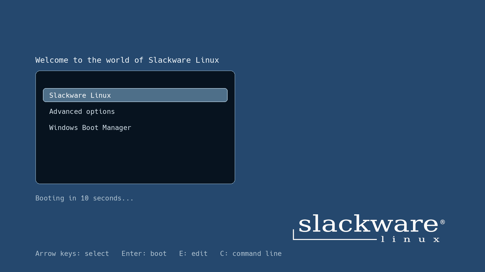
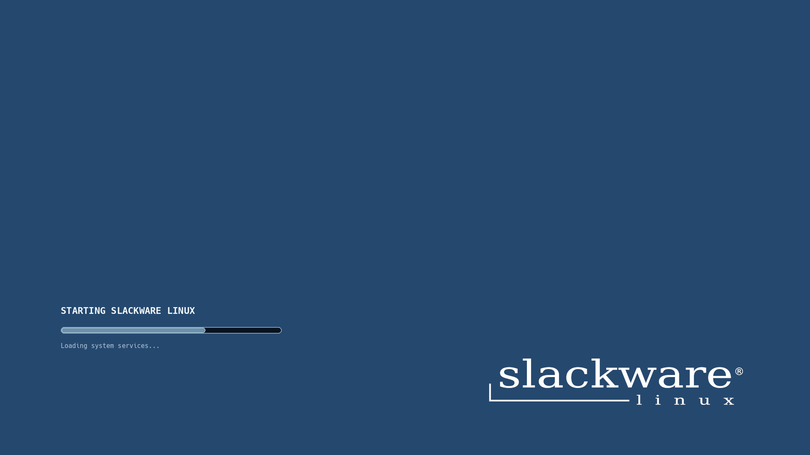
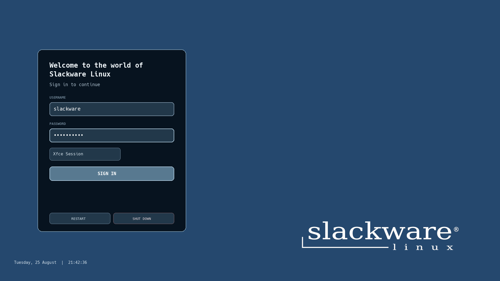
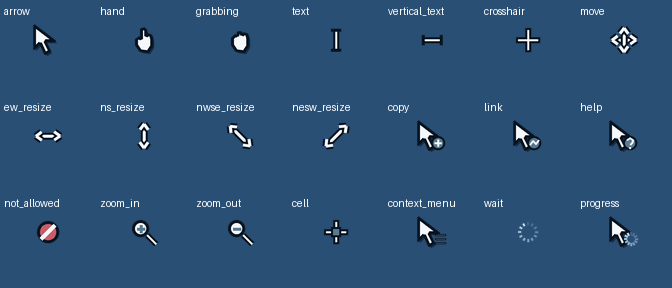

# Slackworld

Slackworld is a coordinated visual theme pack for Slackware Linux. It gives
the system a consistent blue-grey appearance from the GRUB boot menu through
Plymouth and SDDM to the desktop cursor.

The pack contains four independent components. You can install all of them or
use only the parts you need.

## Contents

| Directory | Component | Description |
| --- | --- | --- |
| [`grub/`](grub/) | GRUB theme | A left-aligned boot menu with a translucent panel, a clearly highlighted selection, a boot countdown and keyboard hints. |
| [`plymouth/`](plymouth/) | Plymouth theme | A graphical boot and shutdown splash with password/question dialogs and a calm, continuously moving progress indicator. |
| [`sddm/`](sddm/) | SDDM theme | A minimal Qt 6 login screen with session selection, clock, sign-in, restart and shutdown controls. It does not require KDE Frameworks or Plasma. |
| [`cursor/`](cursor/) | Xcursor theme | A modern multi-resolution cursor theme with static and animated cursors, legacy X11 aliases and compatibility hashes. |

## Previews

Click any image to open it at full resolution.

### GRUB

[](grub/preview.png)

### Plymouth

[](plymouth/preview.png)

[Password prompt preview](plymouth/preview-password.png)

### SDDM

[](sddm/preview.png)

### Cursor

[](cursor/preview-32.png)

Other native cursor sizes:
[16 px](cursor/preview-16.png) ·
[24 px](cursor/preview-24.png) ·
[48 px](cursor/preview-48.png) ·
[64 px](cursor/preview-64.png)

## Requirements

- Slackware Linux
- GRUB 2 for the boot menu theme
- Plymouth with the `script` plugin for the splash theme
- SDDM built with Qt 6 and its Qt Quick/QML runtime for the login theme
- Xcursor support for the cursor theme
- The Hack font
- A GRUB PF2 font whose internal name is `Hack Regular 20`

The supplied backgrounds and layouts are designed primarily for a 1920×1080
display. Plymouth scales its background to the active display size.

## Installation

All system-wide installation commands below require root privileges. Keep a
known-working boot entry and configuration backup while testing boot-related
changes.

### GRUB

Copy the theme:

```sh
sudo mkdir -p /boot/grub/themes/slackworld
sudo cp -a grub/. /boot/grub/themes/slackworld/
```

Set the following values in `/etc/default/grub`:

```sh
GRUB_THEME="/boot/grub/themes/slackworld/theme.txt"
GRUB_GFXMODE=1920x1080x32
```

The theme expects the previously installed GRUB font
`/boot/grub/fonts/hack.pf2` with the internal name `Hack Regular 20`. Rebuild
the GRUB configuration after making changes:

```sh
sudo grub-mkconfig -o /boot/grub/grub.cfg
```

The GRUB directory contains:

- `theme.txt` — layout, colours, fonts and labels;
- `background.png` — full-screen background;
- `menu_*.png` — nine-slice translucent menu panel;
- `item_*.png` — normal-row geometry stabiliser;
- `select_*.png` — nine-slice selected-row highlight.

### Plymouth

Copy and select the theme:

```sh
sudo mkdir -p /usr/share/plymouth/themes/slackworld
sudo cp -a plymouth/. /usr/share/plymouth/themes/slackworld/
sudo plymouth-set-default-theme slackworld
```

The directory contains the theme descriptor and script, the common Slackworld
background, progress-track artwork, title artwork, and images used by password
and question dialogs. The indicator moves smoothly from side to side and does
not depend on an estimated boot percentage, so it also remains useful during
shutdown.

The selected theme must be included in the initrd. On current Slackware
systems using `geninitrd`, select dracut in `/etc/default/geninitrd`:

```sh
GENERATOR=dracut
```

Then rebuild the initrd using the command appropriate for your local dracut
configuration. After rebuilding, you can verify that the theme was included:

```sh
lsinitrd /boot/initrd-generic.img | grep -i slackworld
```

The kernel command line normally needs the `splash` parameter. A manual visual
test can be performed from a suitable graphical or text VT:

```sh
sudo plymouth quit
sudo plymouthd --debug
sudo plymouth show-splash
sleep 15
sudo plymouth quit
```

### SDDM (Qt 6)

Copy the theme:

```sh
sudo mkdir -p /usr/share/sddm/themes/slackworld
sudo cp -a sddm/. /usr/share/sddm/themes/slackworld/
```

Create or edit `/etc/sddm.conf.d/theme.conf`:

```ini
[Theme]
Current=slackworld
```

Preview the theme before enabling it:

```sh
sddm-greeter-qt6 --test-mode --theme /usr/share/sddm/themes/slackworld
```

If your build provides only `sddm-greeter`, use that command instead. Socket
warnings are expected in standalone test mode because there is no running SDDM
daemon connection; login and power actions cannot work in that mode.

Local settings can be placed in `theme.conf.user`:

```ini
[General]
background=slackworld.png
fontFamily=Hack
welcomeText=Welcome to the world of Slackware Linux
```

The implementation uses Qt 6 Qt Quick and SDDM components only. It does not
depend on Plasma, KDE Frameworks, Qt Graphical Effects, Qt Multimedia or an
external icon theme.

### Xcursor

Install for the current user:

```sh
mkdir -p ~/.icons
cp -a cursor/Slackworld ~/.icons/
```

Or install system-wide:

```sh
sudo cp -a cursor/Slackworld /usr/share/icons/
```

In Xfce, select **Slackworld** under **Settings Manager → Mouse and Touchpad →
Theme**. An Xresources fallback is also available:

```text
Xcursor.theme: Slackworld
Xcursor.size: 24
```

The compiled theme contains native 16, 24, 32, 48 and 64 pixel images,
animated `wait` and `progress` cursors, modern cursor names, legacy X11 names
and compatibility hash aliases. Adwaita is used only as a final fallback for
names not supplied by Slackworld.

The `cursor/source/` directory contains the PNG assets, `xcursorgen`
configuration files and the Python builder used to produce the compiled
theme. Its build dependencies are Python 3, Pillow and `xcursorgen`.

## Customisation

- GRUB layout and colours: `grub/theme.txt`
- Plymouth animation and positioning: `plymouth/slackworld.script`
- SDDM text, font and background: `sddm/theme.conf` or a local
  `theme.conf.user`
- Cursor generation: `cursor/source/build_slackworld_cursor.py`

## Notes

- Rebuild the GRUB configuration after changing the GRUB theme.
- Rebuild the initrd after changing the Plymouth theme or its assets.
- Test SDDM from a graphical terminal before selecting it for a real login.
- Do not remove the previous working kernel or boot entry until a newly built
  initrd has completed at least one successful boot.

## Licensing

Cursor licensing and copyright information is included in
[`cursor/LICENSE`](cursor/LICENSE) and [`cursor/COPYRIGHT`](cursor/COPYRIGHT).
Individual components may also declare their own metadata, such as the SDDM
theme's license field.
